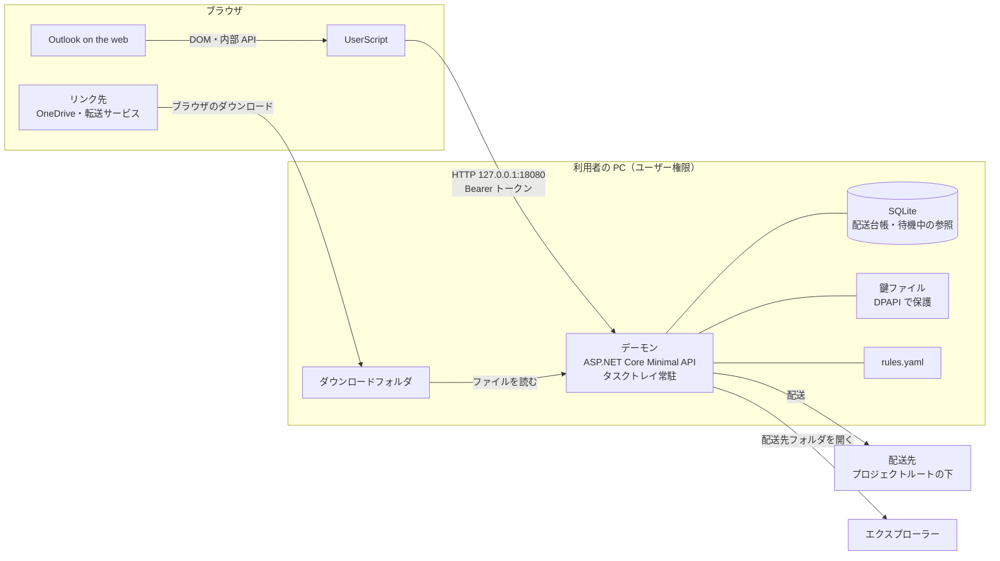
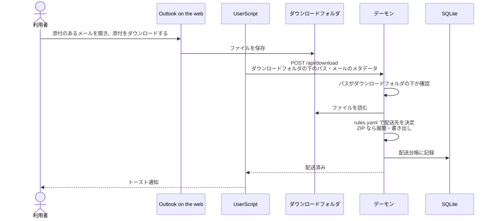
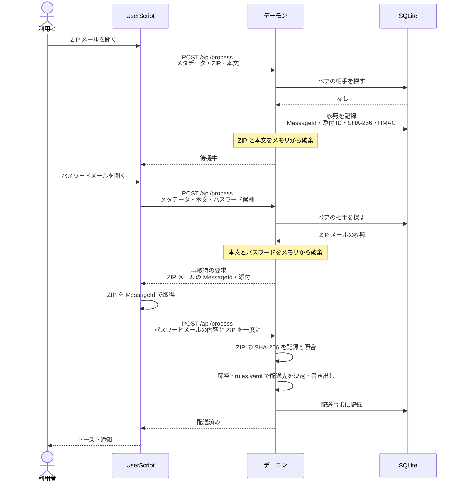
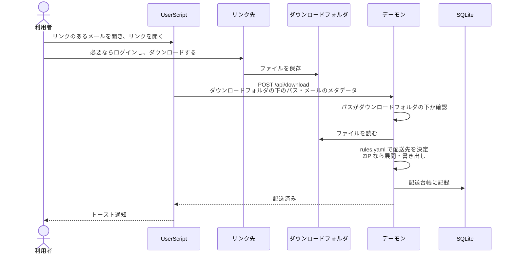
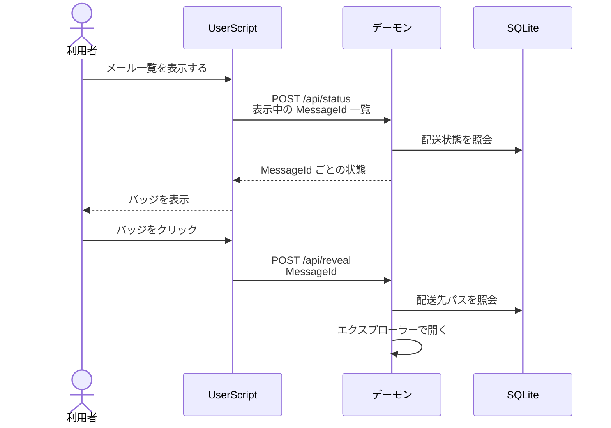

# ppapd アーキテクチャ

ppapd の部品の配置、処理の流れ、データの置き場所を図で示す。要件そのもの（何を満たすか）は [要件定義書](PRD.md) にあり、この文書はそれをどう実現するかを扱う。受け取り経路の番号 R-1〜R-5 は要件定義書の §4 による。

## 部品と境界

ブラウザとデーモンの境界は、ループバックの HTTP とダウンロードフォルダの二つである。デーモンは Outlook on the web にもインターネットにも接続しない。メールの取得と、リンク先のログインとダウンロードは、すべてブラウザ側が行う。

## 処理の流れ

### 添付（R-1、R-2）

UserScript は Outlook の認証トークンを扱わず、添付の中身を自分では取得しない。添付は Outlook の画面のダウンロードで保存されたものを受け取る。理由は [ADR 002](adr/002-attachments-via-downloads.md) にある。

### PPAP（R-3）: ZIP メールが先に届いた場合

パスワードメールが先に届いた場合は、ZIP とパスワードの役割が入れ替わる。デーモンはパスワードメール本文の再取得を要求し、本文の SHA-256 を照合する。

デーモンはリクエストをまたいで ZIP、本文、パスワードを持たない。ペアが揃ったときは、UserScript が両方の内容を一つのリクエストにまとめて送る。

### ダウンロードリンク（R-4、R-5）

### 一覧のバッジ

`/api/reveal` はパスを受け取らない。開くのは配送台帳に記録された配送先だけである。

## データの置き場所

| データ | 置き場所 | 期間 |
| --- | --- | --- |
| 本文、パスワード、平文のアドレスとドメイン | デーモンのメモリ | リクエストの処理中だけ |
| 待機中の参照（MessageId、添付 ID、`ConversationId`、受信日時、ZIP と本文の SHA-256、アドレスとドメインの HMAC-SHA256） | SQLite | ペアが揃うか、破棄の期限まで |
| 配送台帳（MessageId、ファイルの SHA-256、配送先パス、ファイル名一覧） | SQLite | 無期限 |
| HMAC の鍵 | 鍵ファイル（DPAPI で保護） | 無期限 |
| 振り分けの規則、送信者の別名 | `rules.yaml` | 利用者が編集する |
| ダウンロードした添付とリンク先のファイル | ダウンロードフォルダ | 配送まで |
| 配送したファイル | 配送先フォルダ | 利用者が管理する |
