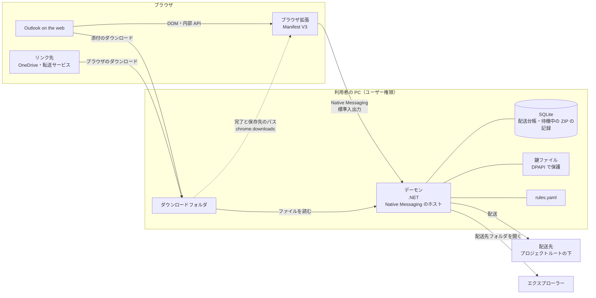
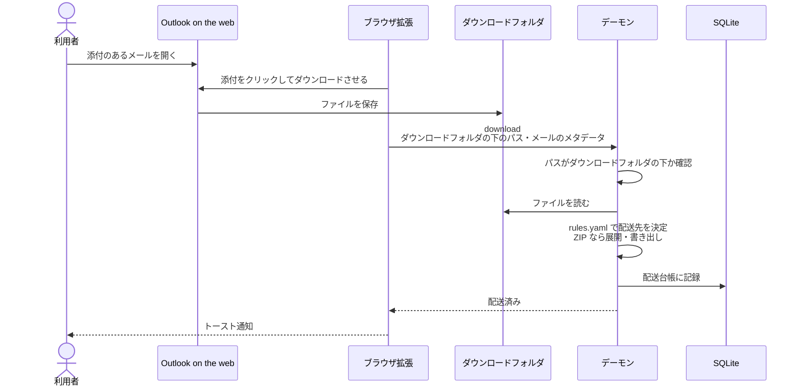
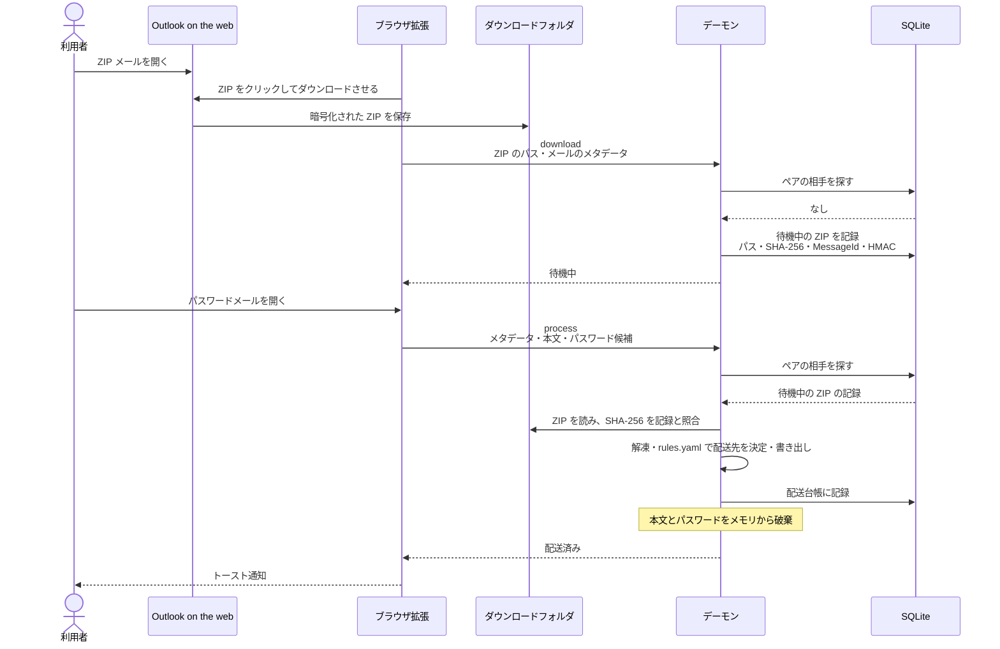
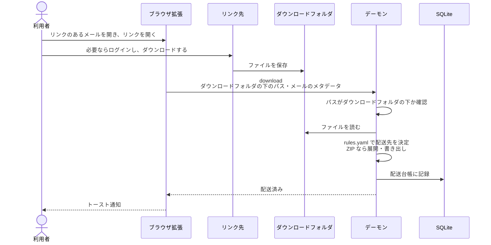
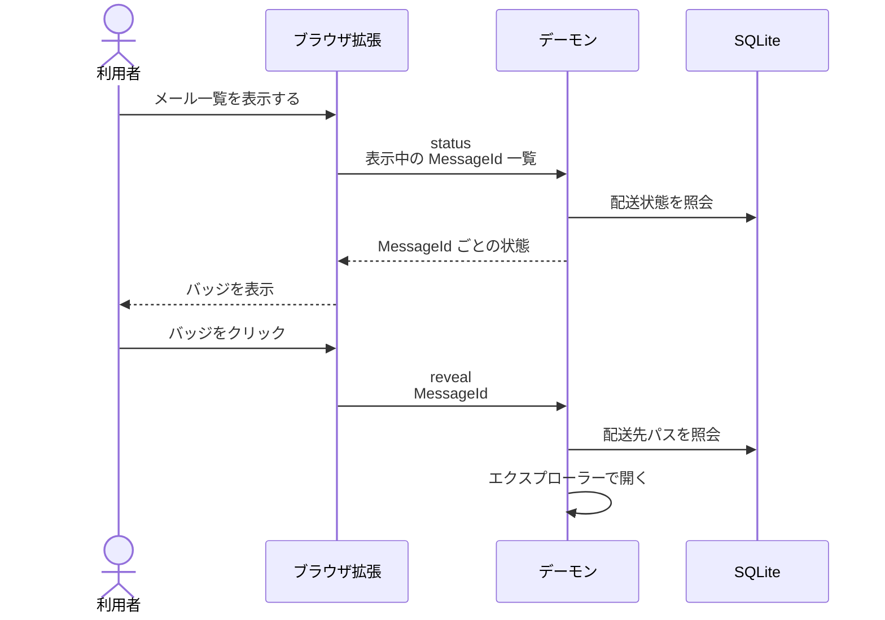

# ppapd アーキテクチャ

ppapd の部品の配置、処理の流れ、データの置き場所を図で示す。要件そのもの（何を満たすか）は [要件定義書](PRD.md) にあり、この文書はそれをどう実現するかを扱う。受け取り経路の番号 R-1〜R-5 は要件定義書の §4 による。

## 部品と境界

ブラウザとデーモンの境界は、Native Messaging とダウンロードフォルダの二つである。デーモンはネットワークのポートで待ち受けない。デーモンは Outlook on the web にもインターネットにも接続しない。メールの取得と、リンク先のログインとダウンロードは、すべてブラウザ側が行う。

## 処理の流れ

### 添付（R-1、R-2）

ブラウザ拡張は Outlook の認証トークンを扱わず、添付の中身を自分では取得しない。Outlook の画面の添付をクリックしてダウンロードさせ、保存されたものを受け取る。2 つ目以降の添付を保存させるには、Outlook のサイトに Chrome の自動ダウンロードが許可されている必要がある。理由は [ADR 002](adr/002-attachments-via-downloads.md) にある。

### PPAP（R-3）: ZIP メールが先に届いた場合

待たせ方の理由は [ADR 001](adr/001-pending-by-reference.md) にある。

### ダウンロードリンク（R-4、R-5）

### 一覧のバッジ

`reveal` はパスを受け取らない。開くのは配送台帳に記録された配送先だけである。

## データの置き場所

| データ | 置き場所 | 期間 |
| --- | --- | --- |
| 本文、パスワード、平文のアドレスとドメイン | デーモンのメモリ | メッセージの処理中だけ |
| 待機中の ZIP の記録（ダウンロードフォルダの下のパス、SHA-256、MessageId、`ConversationId`、受信日時、アドレスとドメインの HMAC-SHA256） | SQLite | ペアが揃うか、破棄の期限まで |
| 待機中の暗号化された ZIP | ダウンロードフォルダ | ペアが揃うまで |
| 待機中のパスワード候補（DPAPI で暗号化） | SQLite | 解凍を試すか、破棄の期限まで |
| 配送台帳（MessageId、ファイルの SHA-256、配送先パス、ファイル名一覧） | SQLite | 無期限 |
| HMAC の鍵 | 鍵ファイル（DPAPI で保護） | 無期限 |
| 振り分けの規則、送信者の別名 | `rules.yaml` | 利用者が編集する |
| ダウンロードした添付とリンク先のファイル | ダウンロードフォルダ | 配送まで |
| 配送したファイル | 配送先フォルダ | 利用者が管理する |
